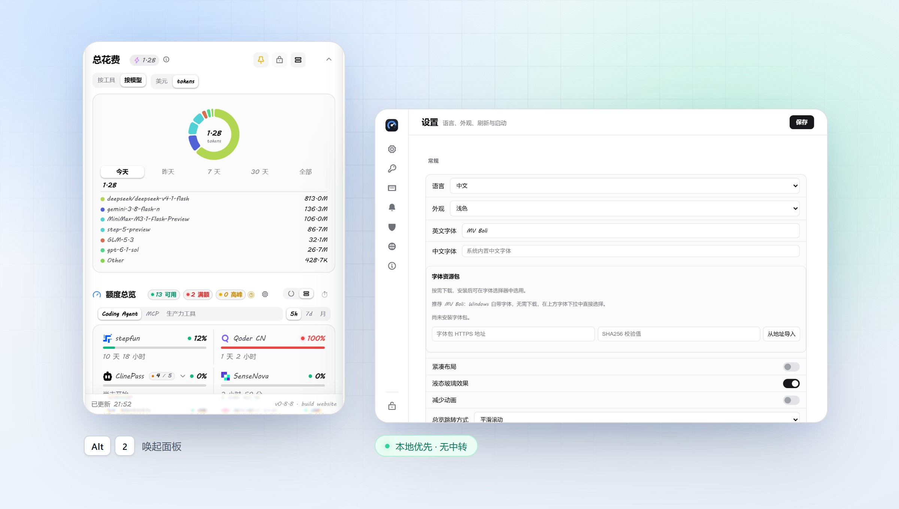
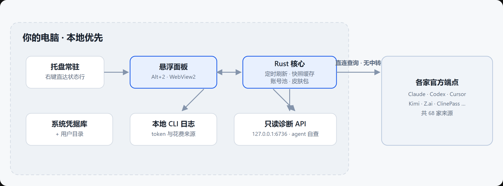
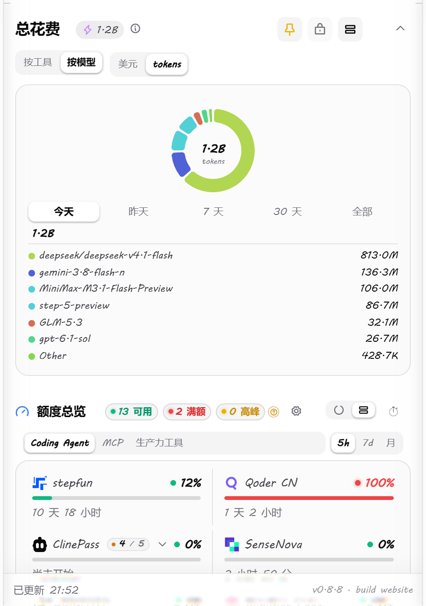
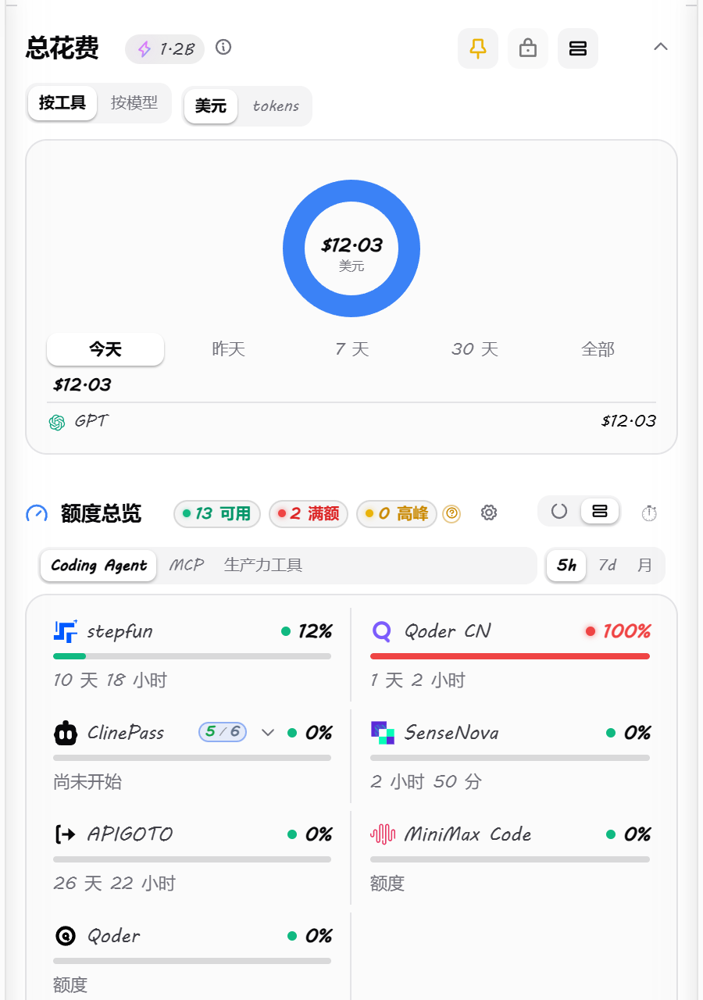
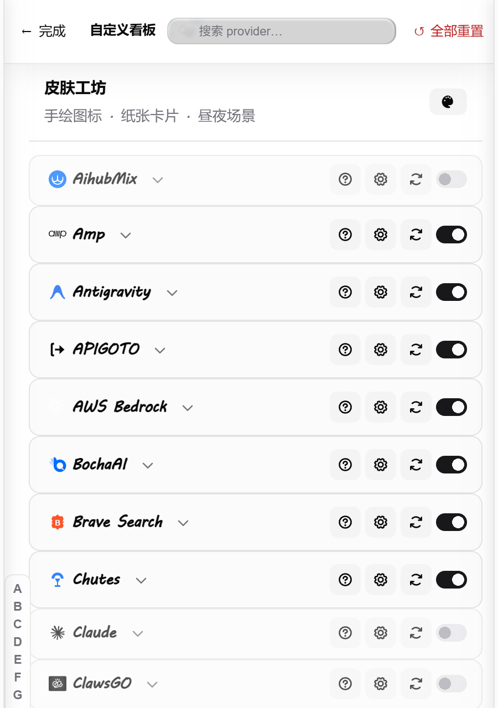
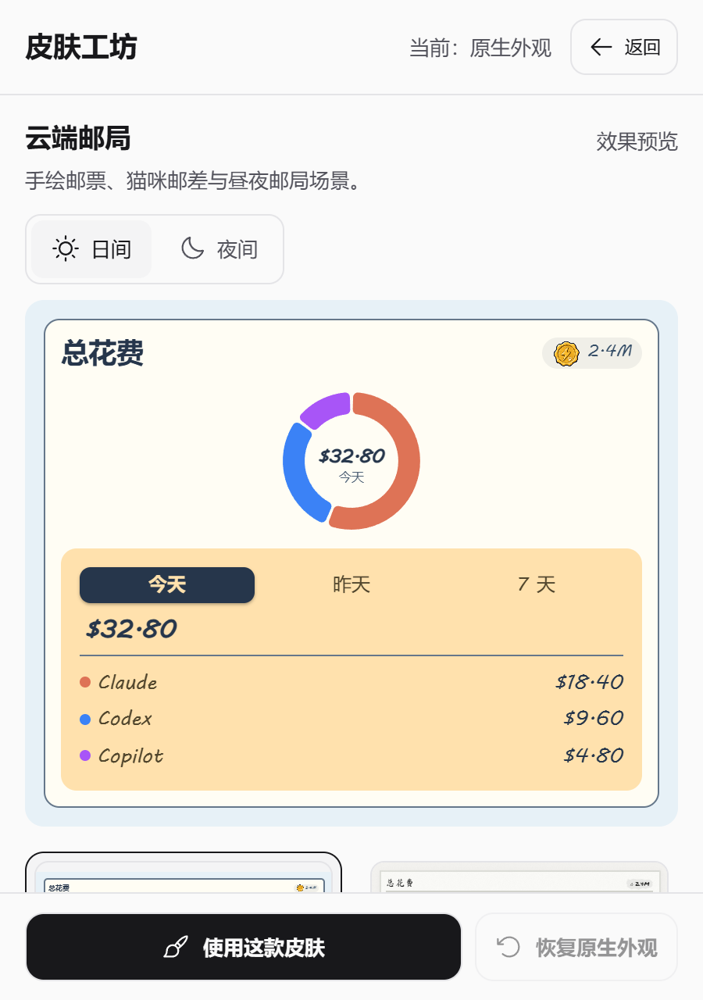
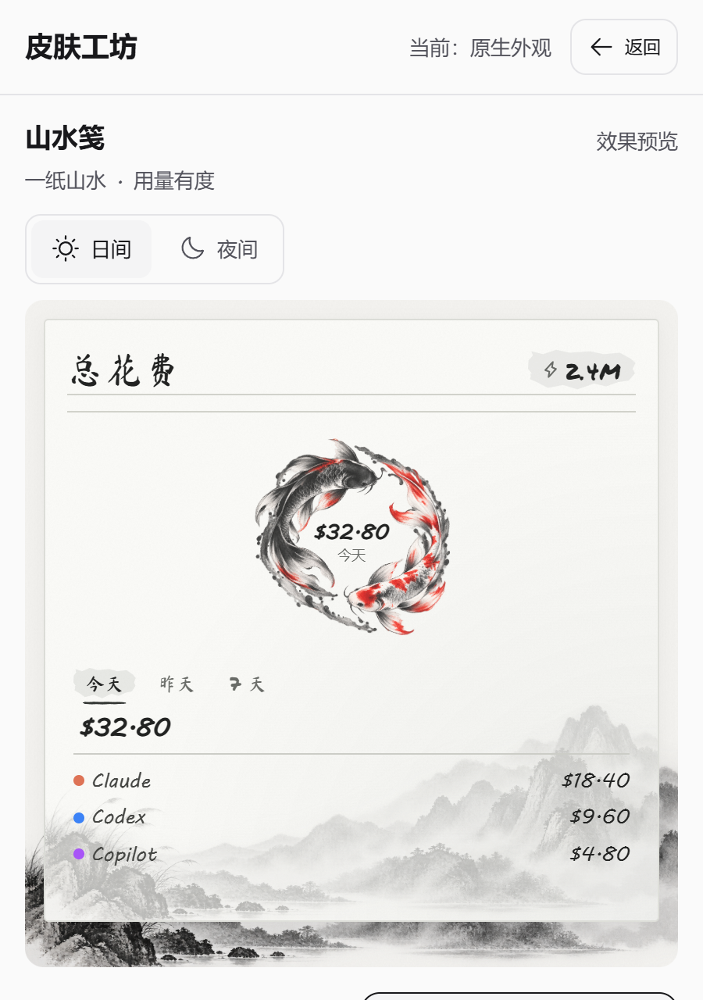
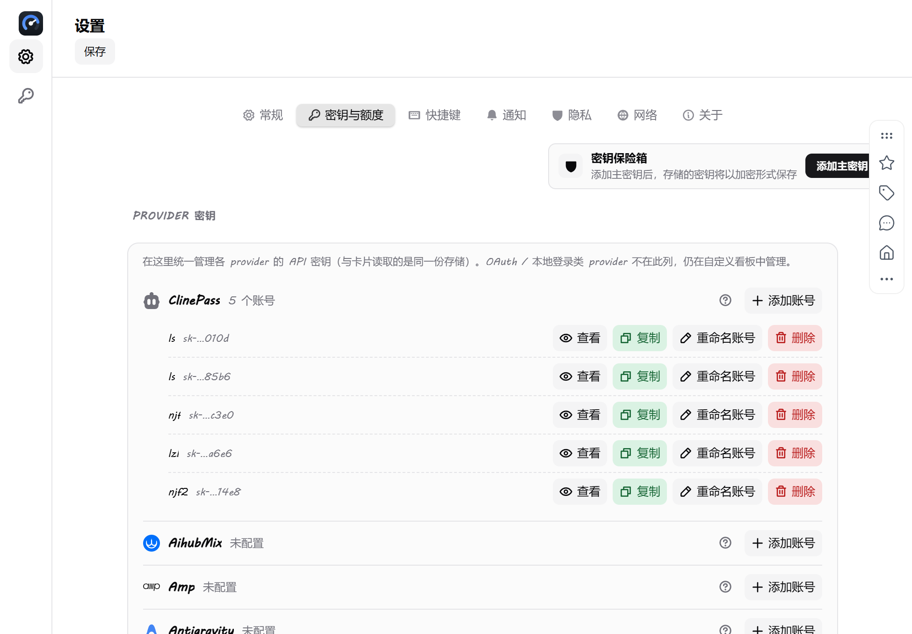
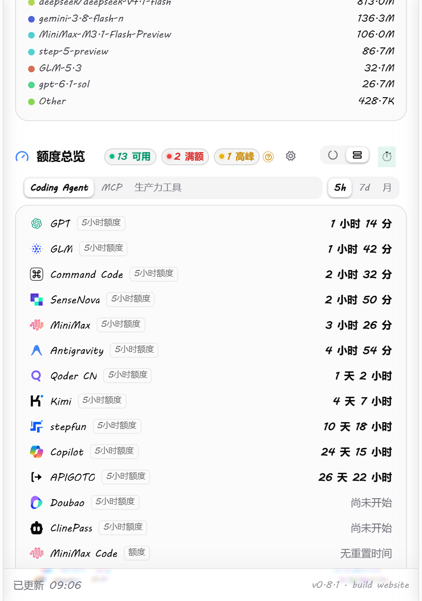

<div align="center">

<a href="https://pane.threetwoa.live"></a>

# Pane

### 常驻托盘的本地用量与额度工作台

**用量、额度、余额与重置时间 —— 一个桌面工作台全看清。**

[](https://github.com/Aafff623/pane/releases) [](https://github.com/Aafff623/pane/actions/workflows/ci.yml) [](https://github.com/Aafff623/pane/releases) [](LICENSE)

[-0078D4.svg?style=flat-square&logo=windows&logoColor=white)](https://github.com/Aafff623/pane/releases/latest) [](https://github.com/Aafff623/pane/releases) [](https://github.com/Aafff623/pane/releases) [](docs/providers.md)

**[下载](#quickstart)** &nbsp;·&nbsp; **[在线演示](https://pane.threetwoa.live)** &nbsp;·&nbsp; **[文档](#docs)** &nbsp;·&nbsp; **[参与](#community)**

**[简体中文](README.md)** · **[English](README_EN.md)**

<picture>
  <source media="(prefers-color-scheme: dark)" srcset="attachments/hero-dark.jpg">
  
</picture>

<sub>悬浮面板 <kbd>Alt + 2</kbd> · 设置窗口 · v0.9.0</sub>

</div>

---

**目录** · [适合你吗](#intro) · [快速开始](#quickstart) · [它能做什么](#features) · [支持来源](#providers) · [它如何工作](#how) · [文档](#docs) · [隐私](#privacy) · [参与](#community)

## <a id="intro"></a>Pane 适合你吗？

每个 AI 工具都把额度放在自己的控制台里：Claude 是 5 小时会话，Codex 看周额度，中转站按 key 计余额，CLI 的花费散落在本地日志。想知道「现在还剩多少、什么时候重置、哪个账号快到顶、今天花了多少」，你得开五个网页、翻三处本地文件。

**Pane 把它们收进一个 `Alt + 2` 随时唤出的桌面面板：**

- **一处看清** —— 5 小时 / 7 天 / 每月额度、余额、重置倒计时与账户状态，`Shift` 一键换挡；
- **本地优先** —— token、cookie 与 API key 只存在本机系统凭据库和用户目录，查询直连各厂商端点，Pane 没有中转后端；
- **常驻不打扰** —— 托盘常驻、每 5 分钟自动刷新（可调），查询失败如实显示为错误状态，而不是灰掉的未知额度。

| | 五个控制台 | **Pane** |
| :-- | :-- | :-- |
| 还剩多少 | 每个平台各看一遍 | 一个面板，5 小时 / 7 天 / 每月一键切换 |
| 何时重置 | 自己算 | 卡面直接给倒计时 |
| 多账号 | 手动切换 | 独立出卡，身份稳定 |
| 花了多少 | 翻 CLI 日志 | 本地扫描，按模型 / 工具拆分 |
| 数据去哪 | 上传云端 | 只在本机，没有中转后端 |

如果上面有两条说的是你，Pane 值得一试。Pane 是 Windows 桌面工具（macOS / Linux 随 Release 提供构建）。

## <a id="quickstart"></a>快速开始

1. **下载安装** —— 从 [Releases](https://github.com/Aafff623/pane/releases/latest) 拿对应平台的安装包。Windows 10/11 (x64) 的 `*-setup.exe` 是主要开发与验证平台；安装后 Pane 进入系统托盘，不需要注册账号。
2. **接入来源** —— `Ctrl + S` 打开设置，按各服务商的提示完成本地登录（Copilot / Codex / Claude 等）或粘贴 API key；未启用的卡片也能先用「⚡ 测试连通性」验证。
3. **日常使用** —— `Alt + 2` 唤出 / 收起面板，`Shift` 在 5 小时 / 7 天 / 每月间切换，`T` 看临期清单，`Esc` 收起回到工作。

不想先安装？[官网在线演示](https://pane.threetwoa.live)由真实前端打包驱动，9 组快捷键和深浅主题都能直接试；演示数据固定，不连接真实账户。

<details>
<summary><b>从源码构建</b></summary>

```powershell
git clone https://github.com/Aafff623/pane.git
cd pane
pnpm install
pnpm build          # 前端（TypeScript 检查 + Vite 构建）
pnpm tauri build    # 完整桌面应用
```

开发模式需要两个进程：Vite 在 `127.0.0.1:1420` 提供前端，`pane.exe` 在 `127.0.0.1:6736` 提供本地 usage API。完整说明见 [开发启动指南](docs/dev-startup.md)。

</details>

## <a id="providers"></a>支持的来源

接入前可查看 [Provider 凭据与查询能力（三张表）](docs/provider-credentials.md)：分别说明 API key、Access Token／Cookie 等专用凭据、本地配置文件，以及套餐和账单权限边界。公开接口与推理协议的依据见 [API 核验记录](docs/provider-api-verification.md)。

当前目录收录 **78 个来源**，三种读取形态：

| 形态 | 覆盖 | 读取方式 |
| --- | --- | --- |
| 本地登录状态 | Claude、Codex、Cursor、Copilot、Antigravity 等 | 本机 IDE / CLI 的登录凭据 + 官方 usage API |
| OAuth 设备流 | Grok、Kiro、SenseNova 等 | 应用内发起，token 自动轮换持久化 |
| API key | DeepSeek、Kimi Code、StepFun、SiliconFlow、Novita 等 | 设置中的 key、环境变量或 CLI 配置 |

同一服务商可以挂**多个账号**独立出卡（ClinePass、One/New API、Custom Relay 等），本地 CLI（Claude Code、Codex CLI、ZCode、OpenCode 等）的花费从日志直接扫描。开箱默认启用主流订阅家族（Claude、Codex、Cursor、Grok、Z.ai、MiniMax、Antigravity、Kimi 等），其余在设置中按需开启。

<details>
<summary><b>全部 72 个服务商一览</b>（与 <code>src/providerCatalog.ts</code> 一致）</summary>

Claude、Codex、CodeBuddy、CodeBuddy CN、WorkBuddy、WorkBuddy AI、Cursor、OpenCode、Copilot、Grok、Devin、MiniMax、OpenRouter、Z.ai、Antigravity、DeepSeek、Kimi API、ElevenLabs、Ollama、Codebuff、Kilo、AihubMix、One/New API、Qwen Code、Hermes、Kimi Code、StepFun、StepFun Step Plan、闪电说、SiliconFlow、Novita AI、Custom Relay、Qoder CN、Trae CN、Command Code、Doubao、ClawsGO、BochaAI、Tavily、Firecrawl、Brave Search、GIPHY、ClinePass、SenseNova、APIGOTO、MiniMax Code、Amp、AWS Bedrock、Chutes、Deepgram、Kiro、OpenAI API、Poe、基元律动、讯飞星火、Venice、Vertex AI、Warp、Windsurf、MiMo、Trae、Qoder、Zed、Droid、JetBrains AI、Groq、Hugging Face、LongCat、sub2api、Mistral、Perplexity、Volcengine Ark

</details>

## <a id="how"></a>它如何工作

<div align="center">
  <picture>
    <source media="(prefers-color-scheme: dark)" srcset="attachments/how-dark.png">
    
  </picture>
</div>

额度查询由 Rust 核心定时发起，**直连各厂商官方端点**，Pane 不在中间转发；token 花费从本地 CLI 日志扫描得出，不经过任何云端服务；凭据存系统凭据库与用户目录；本地只读诊断 API 只监听 `127.0.0.1`。各来源能读哪些指标取决于其接口或本地数据，逐家说明见 [Provider catalog](docs/providers.md)。

## <a id="features"></a>它能做什么

### 额度和花费，一处看清

悬浮面板用一张总览回答「还剩多少、什么时候重置」：绿 / 黄 / 红三态区分可用、高峰和不可用，剩余额度与重置倒计时直接上卡面；`Shift` 在 5 小时 / 7 天 / 每月间切换。查询失败如实显示为错误状态，不伪装成灰色的未知额度；没有月额度的服务商在月视图回退到周额度并标注。

同一张面板也能切到「按工具 / 美元」，看当天花费怎么分——额度与消费不用来回切窗口。

新用户默认使用紧凑条形双列视图。账号可以在测试失败时保存；保存并开启后立即进入总览，查询异常会显示错误类型及修复入口。保存账号不代表已获得套餐或账单读取权限。

<table>
  <tr>
    <td width="50%" align="center" valign="top">
      <picture>
        <source media="(prefers-color-scheme: dark)" srcset="attachments/overview-dark.png">
        
      </picture><br/>
      <sub>5 小时会话视图</sub>
    </td>
    <td width="50%" align="center" valign="top">
      <picture>
        <source media="(prefers-color-scheme: dark)" srcset="attachments/spend-tool-dollar-dark.png">
        
      </picture><br/>
      <sub>按工具 / 美元视图</sub>
    </td>
  </tr>
</table>

**长墙镜像**：周 / 月额度打满时，短周期环直接镜像墙状态（100% + 刷新倒计时），消除「5 小时环还绿着但请求全被拒」的假象；额度耗尽给出可读解释（如 `Weekly limit reached · resets in 2d 21h`），而不是空详情的裸红环。

### 来源接入

78 家按三种认证形态接入，每张卡都有「⚡ 测试连通性」（未启用也可测，状态栏显示 `连通正常 · N ms`）和「? 额度查询说明」（按认证形态给出 key / OAuth / 本地登录的步骤模板与控制台直链）。Customize 抽屉里就地搜索、自定义分组（🥚🐑）、两级备注，移除的 Provider 随时恢复：

> 分类标签按 **Coding Agent / 生产力工具 / MCP 搜索**切换；已删除的 Provider 收进抽屉底部，一键找回。

<div align="center">
  <picture>
    <source media="(prefers-color-scheme: dark)" srcset="attachments/customize-dark.png">
    
  </picture>
</div>

<details>
<summary><b>多账号管理</b> —— 同一服务商添加多个账号，分别查看额度</summary>

- 在「设置 → 用量」添加账号：支持多账号的 API key 服务商，以及 Codex、Cursor、基元律动等登录类服务商，均使用各自的添加入口；
- Codex 自动读取本地 CLI 登录，也可通过 OAuth 添加其他订阅账号；本地登录显示为只读来源，Pane 管理的账号可单独重命名、归档和删除；
- 每个账号保留稳定的本地身份；总览将同一服务商的账号折叠展示，可展开切换查看；
- 右键账号可归档，归档后在设置中恢复；删除时可选择保留用量历史；
- 「Provider 名称」修改卡片标题，「子账号名称」修改单个账号备注；API key 账号池还支持设定默认账号。

</details>

### 花费，有迹可循

读取本地 CLI 日志计算消费，不经过任何云端服务；支持美元与 token 双视图，按模型展开明细：

| 能力 | 说明 |
| :--- | :--- |
| 今日 / 昨日 / 近 30 天 | 按窗口汇总 token 与美元 |
| 模型明细 | 按模型拆分花费与 token，未知价格保留事实并标注未计价 |
| Provider 趋势 | 额度趋势旁显示该 Provider 的已消费 Credits 或实测 Tokens |
| 365 天热力图 | 回看每日使用强度 |
| 分档图标 | 花费卡图标按日 token 量渐变，阈值可自定义 |
| 复制为图片 | 总花费卡先选时间范围（今天 / 昨天 / 7 天 / 30 天 / 全部）再生成分享图；provider 卡即时整卡快照 |

各 CLI 的计量口径见 [Token 花费覆盖](docs/token-spend-coverage.md)。

### 皮肤工坊

深浅主题一键切换（`Ctrl + L`）；**皮肤市场为实验性功能，默认隐藏**，需在设置中二次确认开启。内置两套皮肤：**云端邮局**（手绘邮票、猫咪邮差）与**山水笺**（水墨、锦鲤、纸张纹理），都随深浅主题切换。工坊是画廊式布局：上方完整预览当前选中皮肤（以总花费面板为样张），下方缩略图浏览，底部「使用这款皮肤 / 恢复原生外观」常驻；日间 / 夜间 / 并排三种预览模式，切换时保留滚动位置与键盘焦点。

<table>
  <tr>
    <td width="50%" align="center" valign="top">
      <picture>
        <source media="(prefers-color-scheme: dark)" srcset="attachments/skins-dark.png">
        
      </picture><br/>
      <sub>云端邮局 · 手绘邮票</sub>
    </td>
    <td width="50%" align="center" valign="top">
      <picture>
        <source media="(prefers-color-scheme: dark)" srcset="attachments/skins-ink-dark.png">
        
      </picture><br/>
      <sub>山水笺 · 水墨锦鲤</sub>
    </td>
  </tr>
</table>

<details>
<summary><b>资源包格式</b></summary>

皮肤以资源包分发：zip 内含 `manifest.json`（id、名称、版本、minAppVersion、入口 CSS、逐文件 sha256）+ 资产文件。安装 = 解压 + 逐文件校验 + manifest 合法性检查，任何一项不过整包拒装不留残骸；已装包落在 `%APPDATA%\Pane\skins\<id>\`，重启后仍从磁盘恢复。壁纸、吉祥物和退出交互成套换装，关闭即热切回原生皮肤。设计文档见 [皮肤市场设计](docs/skin-market-design.md)。

</details>

### 密钥，留在本机

provider 主密钥、全部子账号密钥**以及登录类令牌**（OAuth / 登录刷新令牌、Cursor / Codex 账号令牌、检索 key）都存入**系统凭据库**（Windows 凭据管理器等），JSON 文件只留非机密字段；旧版本的明文条目在首次读取时自动迁移，钥匙串写入成功才删除明文。「密钥与额度」页每一行都需**主密码验证**才能查看明文，明文不上屏、可一键复制；本机登录类行内显示绿色「已连接」并写明读取来源。

<details>
<summary><b>凭据存储、明文查看与快捷键</b></summary>

| | |
| :--- | :--- |
| **凭据存储** | 系统凭据库 + 用户目录，不上传、不进 Git |
| **查看明文** | 主密码验证后逐行解锁，可复制、不驻屏 |
| **快捷键** | 9 组内置、全行冲突检测、逐键重录、一键还原 |

<div align="center">
  <picture>
    <source media="(prefers-color-scheme: dark)" srcset="attachments/settings-keys-dark.png">
    
  </picture>
</div>

</details>

<details>
<summary><b>让 AI Agent 自己排查 Pane</b> —— 只读诊断 API + 排查 Skill</summary>

Pane 内置**只读诊断 API**（仅监听 `127.0.0.1`、无鉴权、**永不出凭据**，错误文本中的网址也打码）和一个排查 Skill。装上后直接对 coding agent（Claude Code / Codex / Cursor / ZCode 等）说「帮我查一下 Pane 哪个卡有问题」，它会自己定位原因并给出修复步骤——不用等发版：

```powershell
curl -s --noproxy '*' http://127.0.0.1:6736/v1/doctor     # 一句话健康结论 + 每项失败的修复办法
curl -s --noproxy '*' http://127.0.0.1:6736/v1/providers  # 每张卡的状态 / 错误 / 是否过期
curl -s --noproxy '*' http://127.0.0.1:6736/v1/status     # 版本 / 运行时长 / 刷新年龄
curl -s --noproxy '*' http://127.0.0.1:6736/v1/sources    # 本机花费数据源清单
```

Skill 三选一安装：`install.ps1` 安装器自动装入、设置 → 常规 → **AI Agent 排查 Skill → 安装**、或从仓库 [`skills/pane/`](skills/pane/) 获取（支持 `npx skills add Aafff623/pane`）。完整契约见 [本地 HTTP API](docs/local-http-api.md)。

</details>

<details>
<summary><b>还有</b> —— 新手引导、临期清单、托盘、更新、设置与字体、缩放…</summary>

- **新手引导** —— 首次安装自动播放 5 步聚光灯引导（上一步 / 下一步 / 跳过，`Esc` 退出），老用户不被打扰；设置 → 常规「重新演示」随时重看；
- **临期清单** —— `T` 呼出，按重置时间排序，顶部就是「该行动」的部分；
- **托盘直达** —— 右键直出各 provider 状态行（读本地快照，零网络请求）与设置入口；
- **更新不打断** —— 检测到新版本时总花费横栏出现轻量 ↑ 指示器，点击原地下载，圆环按真实字节进度填充，完成后自动安装重启；
- **设置与字体** —— 各设置页统一 940px 内容列并垂直居中；密钥与额度页按 A–Z 排列、左侧字母索引直达；英文与中文字体分开配置，字体栈按拉丁 → 中文 → 系统回退；
- **四角等比缩放** —— 设置中开启四角手柄，拖动时窗口、字体与图标整体等比缩放，记住尺寸，可一键恢复默认大小；
- **更新日志时间线** —— 主界面卡片列表下方按版本显示新增 / 变更 / 修复，点击查看完整日志；
- **三语界面** —— 简体中文 / English / Русский，跟随系统或手动切换；
- **开机动画** —— 弹出主窗时的品牌动画可开关、可重播，系统减动效时停格成片帧退场；
- **字体资源包** —— 与皮肤包同一套 zip + manifest + sha256 校验，在设置字体附近按需下载安装，装完即进字体下拉；官方目录当前为空，推荐先用 Windows 自带的 MV Boli；

<details>
<summary><b>全部 9 组内置快捷键</b></summary>

| 快捷键 | 作用 |
| :--- | :--- |
| `Alt + 2` | 快速唤醒 / 收起悬浮面板（默认，可自定义） |
| `Esc` | 收起面板，回到当前工作 |
| `Shift` | 依次切换 5 小时 / 7 天 / 每月额度周期 |
| `Shift + 1` | 切换分类标签 |
| `Ctrl + S` | 打开设置面板 |
| `Ctrl + E` | 打开自定义看板 |
| `Ctrl + L` | 切换深浅主题 |
| `Ctrl + R` | 立即刷新用量 |
| `T` | 查看临期清单 |

</details>

<div align="center">
  <picture>
    <source media="(prefers-color-scheme: dark)" srcset="attachments/expiring-dark.png">
    
  </picture>
</div>

</details>

## <a id="docs"></a>文档

| | |
| :--- | :--- |
| [开发启动指南](docs/dev-startup.md) | [Provider catalog](docs/providers.md) |
| [本地 HTTP API](docs/local-http-api.md) | [Token 花费覆盖](docs/token-spend-coverage.md) |
| [隐私说明](docs/privacy.md) | [皮肤市场设计](docs/skin-market-design.md) |
| [工程事实与约束](docs/project-facts.md) | [领域词汇表](CONTEXT.md) |
| [README 素材维护](docs/readme-assets.md) | [更新日志](CHANGELOG.md) |
| [厂商情报](docs/provider-intel.md) | [更新机制](docs/update-mechanism.md) |

## <a id="privacy"></a>隐私

Pane 是 local-first 工具：token、cookie 和 API key 保存在系统凭据库与 Windows 用户目录，不提交到 Git、不上传；查询请求只发送到对应 provider 的端点，Pane 没有中心后端替你转发额度；本地 HTTP API 只监听 loopback 并对敏感字段脱敏；遥测默认不承载额度、消费或 provider 凭据，可在设置中关闭。详见 [`docs/privacy.md`](docs/privacy.md)，安全披露流程见 [`SECURITY.md`](SECURITY.md)。

## <a id="community"></a>参与

欢迎提交 issue、provider 适配、UI 改进和文档修订。提交前请说明：改动影响的 provider 或用户路径、使用了哪些本地数据或外部 API、如何验证。新功能走 `codex/<feature>` 分支，验证通过后合并回 `main`；详见 [`CONTRIBUTING.md`](CONTRIBUTING.md)。UI 验收由维护者本人完成——真实界面证据优先于代码阅读。

<div align="center">

<a href="https://star-history.com/#Aafff623/pane&Date">
  <picture>
    <source media="(prefers-color-scheme: dark)" srcset="https://api.star-history.com/svg?repos=Aafff623/pane&type=Date&theme=dark" />
    
  </picture>
</a>

</div>

## <a id="license"></a>许可证

本项目采用 [MIT License](LICENSE) 授权。Copyright (c) 2026 Jazii (Pane for Windows)
